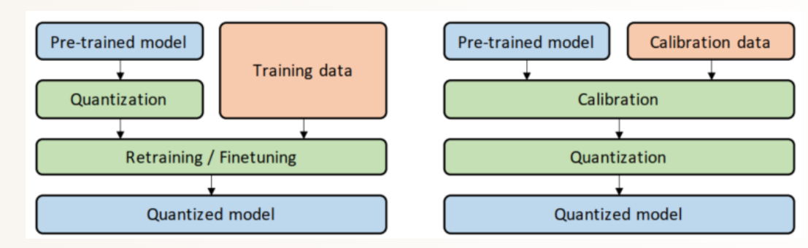

# **Quantization for BEVFusion**
BEVFusion's SparseConvolution module uses the **[mmdet3d/spconv](https://github.com/mit-han-lab/bevfusion/tree/main/mmdet3d/ops/spconv)**

### **QAT Workflow** 
* Insert Q&DQ nodes to get fake-quant pytorch model
* PTQ calibration
* QAT Training
#### What is the difference between QAT & PTQ? (left is QAT, right is PTQ)

### **Notes**
* FuseBn can bring better performance to the model forward, so this operation needs to be completed before model calibration.

* The Add and Concat layers have multiple inputs，need to use the same quantizer for all inputs, thus reducing the occurrence of Reformat.

* The quantization of some layers will cause a significant drop in mAP, so it is necessary to disable the quantization of these layers after calibration.
<br>

### **Usage**
### 1. Configuring the bevfusion runtime environment
- [Here](https://github.com/mit-han-lab/bevfusion#prerequisites) is the official configuration guide.
- Setup the bevfusion runtime environment:
```bash
# build image from dockerfile
cd CUDA-BEVFusion/bevfusion/docker
docker build . -t bevfusion

# creating containers and mapping volumes
nvidia-docker run -it -v `pwd`/../../../:/Lidar_AI_Solution \
     -v /path/to/nuScenes:/data \
     --shm-size 16g bevfusion   

# install python dependency libraries
cd /Lidar_AI_Solution/CUDA-BEVFusion
pip install -r tool/requirements.txt

# install bevfusion
cd bevfusion
python setup.py develop
```

### 2. Download model.zip and nuScenes-example-data.zip
- download model.zip from ( [Google Drive](https://drive.google.com/file/d/1bPt3D07yyVuSuzRAHySZVR2N15RqGHHN/view?usp=sharing) ) or ( [Baidu Drive](https://pan.baidu.com/s/1_6IJTzKlJ8H62W5cUPiSbA?pwd=g6b4) )
- download nuScenes-example-data.zip from 
( [Google Drive](https://drive.google.com/file/d/1RO493RSWyXbyS12yWk5ZzrixAeZQSnL8/view?usp=sharing) ) or ( [Baidu Drive](https://pan.baidu.com/s/1ED6eospSIF8oIQ2unU9WIQ?pwd=mtvt) )

```bash
# download models and datas to CUDA-BEVFusion
cd CUDA-BEVFusion

# unzip models and datas
apt install unzip
unzip model.zip
unzip nuScenes-example-data.zip

# copy yaml to bevfusion
cp -r configs bevfusion
```

### 3. Export INT8 model

```bash
python qat/export-camera.py --ckpt=model/resnet50int8/bevfusion_ptq.pth
python qat/export-transfuser.py --ckpt=model/resnet50int8/bevfusion_ptq.pth
python qat/export-scn.py --ckpt=model/resnet50int8/bevfusion_ptq.pth --save=qat/onnx_int8/lidar.backbone.onnx
```

### 4. Export FP16 model
```bash
python qat/export-camera.py --ckpt=model/resnet50int8/bevfusion_ptq.pth --fp16
python qat/export-transfuser.py --ckpt=model/resnet50int8/bevfusion_ptq.pth --fp16
python qat/export-scn.py --ckpt=model/resnet50int8/bevfusion_ptq.pth --save=qat/onnx_fp16/lidar.backbone.onnx
```

## 5. Generate PTQ model
- This code uses the [nuScenes Dataset](https://www.nuscenes.org/). You need to download it in order to run PTQ.
  - You can follow the tips [here](https://github.com/mit-han-lab/bevfusion#data-preparation) to prepare the data.
```bash
python qat/ptq.py --config=bevfusion/configs/nuscenes/det/transfusion/secfpn/camera+lidar/resnet50/convfuser.yaml --ckpt=model/resnet50/bevfusion-det.pth --calibrate_batch 300
```

### nuScenes-mini PTQ (project environment)

The mini dataset does not include the map-expansion JSON files required by `LoadBEVSegmentation`. The PTQ script's `--dataset-root` mode skips map segmentation and object-paste transforms. On a 10 GB GPU, the verified calibration/export setup uses 128x352 camera inputs:

```bash
source /home/scut/anaconda3/etc/profile.d/conda.sh
conda activate /home/scut/CX/Lidar_AI_Solution/.conda-bevfusion-eval
cd /home/scut/CX/Lidar_AI_Solution/CUDA-BEVFusion
source tool/environment.sh

python qat/ptq.py \
  --config bevfusion/configs/nuscenes/det/transfusion/secfpn/camera+lidar/resnet50/convfuser.yaml \
  --ckpt model/resnet50/bevfusion-det.pth \
  --dataset-root /home/scut/CX/Lidar_AI_Solution/dataset/nuScenes-mini \
  --image-size 128 352 \
  --calibrate_batch 80 \
  --save qat/ckpt/bevfusion_ptq_nuscenes-mini_128x352.pth

python qat/export-camera.py \
  --ckpt qat/ckpt/bevfusion_ptq_nuscenes-mini_128x352.pth \
  --save-dir qat/onnx_int8_nuscenes-mini_128x352
python qat/export-transfuser.py \
  --ckpt qat/ckpt/bevfusion_ptq_nuscenes-mini_128x352.pth \
  --save-dir qat/onnx_int8_nuscenes-mini_128x352
python qat/export-scn.py \
  --ckpt qat/ckpt/bevfusion_ptq_nuscenes-mini_128x352.pth \
  --save qat/onnx_int8_nuscenes-mini_128x352/lidar.backbone.onnx
```

The 128x352 mini result is for local validation and is not directly comparable to metrics produced with the standard 256x704 input. The bbox head ONNX contains `nv::CustomLayerNormalization` and requires the TensorRT plugin when building an engine.

## 6. Evaluating mAP with PyBEV
```bash
cd CUDA-BEVFusion
cp qat/test-mAP-for-cuda.py bevfusion/tools

cd bevfusion
mkdir data
ln -s /path/to/nuScenes data/nuscenes

python tools/test-mAP-for-cuda.py
```

### **Workflow in QAT Mode** 
The performance metrics of the PTQ INT8 model are already very close to fp16, and work on the QAT part will follow.